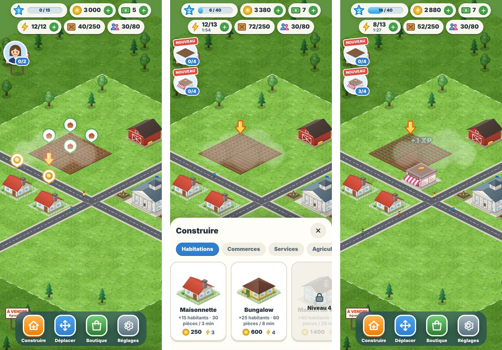

# City Ville

City-builder isométrique **mobile-first** (jouable aussi sur ordinateur), inspiré des jeux de gestion de ville
des années 2010 : on encaisse des loyers, on cultive des champs, on approvisionne des commerces, on agrandit
sa ville et on suit les objectifs de Léa, l'adjointe au maire.

> **Prototype V1** : graphismes générés par le code (provisoires), paiements simulés, sauvegarde locale.



## Démarrer

Prérequis : Node.js 22.12 ou plus récent.

```bash
npm install
npm run dev        # http://localhost:5173 (et l'adresse réseau pour tester sur téléphone)
```

Pour jouer sur votre téléphone pendant le développement : connectez-le au même Wi-Fi que l'ordinateur et ouvrez
l'adresse « Network » affichée par `npm run dev`.

| Commande           | Rôle                                            |
| ------------------ | ----------------------------------------------- |
| `npm run dev`      | Serveur de développement (rechargement à chaud) |
| `npm run build`    | Vérification des types puis build de production |
| `npm run preview`  | Sert le build de production localement          |
| `npm test`         | Tests unitaires (Vitest) de la logique de jeu   |
| `npm run lint`     | ESLint                                          |
| `npm run format`   | Formatage Prettier                              |
| `npm run check`    | Types + lint + format + tests (comme la CI)     |
| `npx convex dev`   | Serveur en ligne de développement (voir docs)   |
| `npm run ios:sync` | Compile et copie le jeu dans le projet iOS      |
| `npm run ios:open` | Ouvre le projet dans Xcode                      |

La planche de tous les visuels générés est disponible en développement sur `/art.html`, l'interface admin sur
`/admin.html`. Mise en ligne : [docs/MISE_EN_LIGNE.md](docs/MISE_EN_LIGNE.md) ; iPhone : [docs/IOS.md](docs/IOS.md).

## Ce que contient la V1

- **Carte isométrique** de 40 × 40 cases : déplacement au doigt avec inertie, zoom par pincement ou molette.
- **Constructions** : habitations (loyers + habitants), commerces (marchandises → recettes), bâtiments publics
  (population maximale), stockage, champs, décorations (bonus de revenus à proximité) et routes.
- **Chantiers à minuteur** (de 30 s à 16 h selon le bâtiment), puis inauguration ; accélérables contre du cash.
- **Cultures** : 9 cultures, des fraises (5 min) aux pommes (24 h) ; mode plantation en série.
- **Pêche** : ville au bord de la mer, ponton / port de pêche / port industriel, sorties en mer.
- **Progression jusqu'au niveau 30** (~3 semaines), 66 constructions, calibrée par un joueur simulé.
- **Deux rives** séparées par un bras de mer, reliées par un pont (niveau 15) ; **cycle jour/nuit**.
- **En ligne** (serveur Convex) : pseudo, sauvegarde synchronisée, voisins (visite, coup de main quotidien),
  classement, **marché** entre joueurs, **chat** (salon Monde + salon de sa langue), signalement et blocage.
  Sans serveur : mode démo hors-ligne.
- **Rôles** : un seul **administrateur** (désigné en ligne de commande) accède à l'interface admin et aux
  données ; il nomme des **modérateurs** qui modèrent le chat depuis le jeu.
- **Interface admin** (`/admin.html`) : joueurs actifs, rétention J1/J7/J30, temps de jeu, progression, langues,
  **annonces** à tous les joueurs (ou par langue), équipe, modération du chat et des signalements.
- **11 langues** : français, anglais, espagnol, portugais, allemand, italien, russe, turc, japonais, coréen,
  chinois — choisie à l'inscription (proposée d'après l'appareil), modifiable dans les réglages.
- **Défis du jour**, **centre de notifications**, messages en jeu regroupés (« 4 champs sont prêts ! »),
  résumé au retour, et **notifications de l'appareil** proposées au bon moment (iPhone : même jeu fermé).
- **Application iPhone** (Capacitor) : voir [docs/IOS.md](docs/IOS.md).
- **Économie** : pièces, cash (monnaie premium), énergie qui se recharge, XP et niveaux avec déblocages.
- **Objectifs guidés** (25) avec flèches d'aide, récompenses et passages de niveau.
- **Agrandissements** de la ville par zones de 8 × 8.
- **Mode édition** : déplacer ou vendre une construction.
- **Boutique** : packs de cash (paiement simulé) et échanges cash → pièces / énergie.
- **Sauvegarde automatique** locale, progression hors-ligne (les cultures poussent pendant votre absence).
- **Bruitages** synthétisés, habitants qui se promènent, nuages, effets de récompense.
- **Outils de test** dans les réglages (pièces, niveau, avance rapide du temps).

## Structure

```
src/
  core/        Logique de jeu pure (aucune dépendance au rendu) + tests
  data/        Contenu et équilibrage : bâtiments, cultures, objectifs, produits, ville de départ
  render/      Rendu Phaser 4 : scène, caméra, effets, habitants, dessins procéduraux (art/)
  ui/          Interface HTML/CSS superposée : barre de ressources, menus, fenêtres, boutique
  services/    Paiement (interface + fournisseur de test), stockage, sons
  app/         Contexte partagé et bus d'évènements entre le monde et l'interface
docs/          Architecture, game design, monétisation, feuille de route
```

Détails : [docs/ARCHITECTURE.md](docs/ARCHITECTURE.md) · [docs/GAME_DESIGN.md](docs/GAME_DESIGN.md) ·
[docs/MONETIZATION.md](docs/MONETIZATION.md) · [docs/ROADMAP.md](docs/ROADMAP.md)

## Contrôles

| Action                    | Mobile                                        | Ordinateur                                            |
| ------------------------- | --------------------------------------------- | ----------------------------------------------------- |
| Se déplacer               | Glisser                                       | Cliquer-glisser                                       |
| Zoomer                    | Pincer                                        | Molette                                               |
| Agir sur une construction | Toucher                                       | Clic                                                  |
| Placer une construction   | Toucher la carte, puis la construction (ou ✓) | Cliquer la carte, puis la construction (ou ✓, Entrée) |
| Tracer des routes         | Glisser depuis la route fantôme               | Cliquer-glisser depuis la route fantôme               |
| Annuler                   | ✗                                             | Échap                                                 |

## Nom et droits

« CityVille » est une marque de Zynga. **City Ville** est un nom de travail : prévoir un nom, un univers et des
visuels originaux avant toute publication (le nom est centralisé dans `src/config.ts`). Les mécaniques de jeu
ne sont pas protégées, mais les noms, personnages et graphismes le sont.
